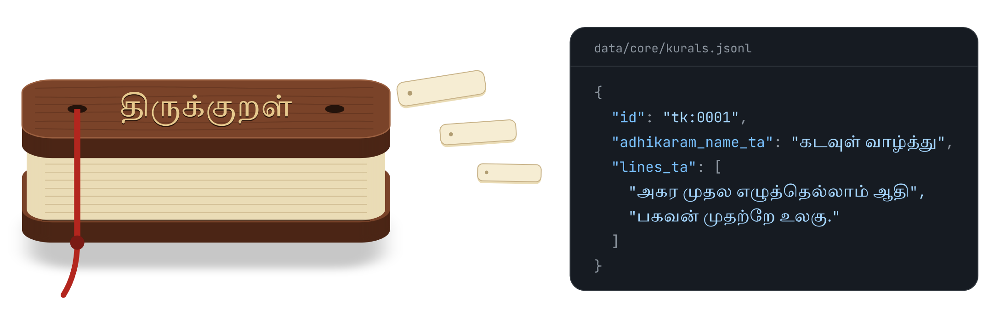
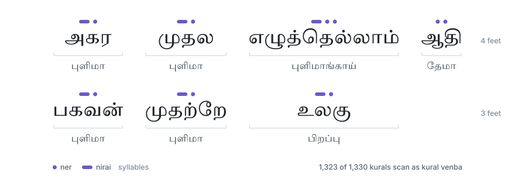
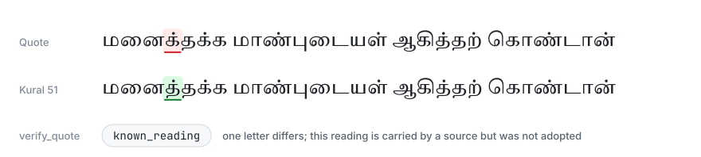
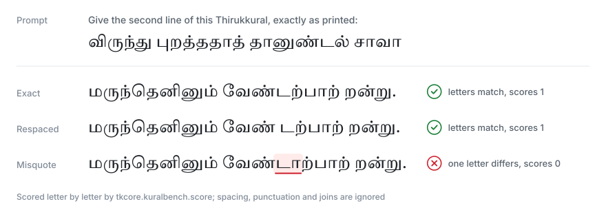
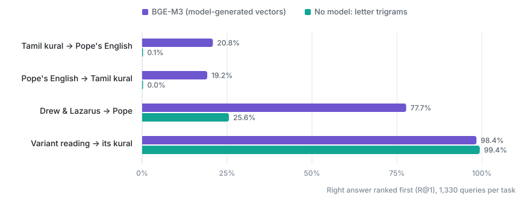
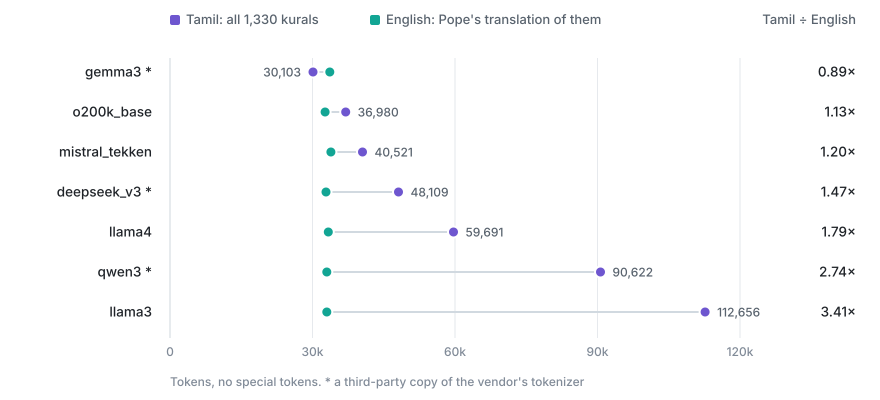

<h1 align="center">Thirukkural Tamil Dataset · திருக்குறள்</h1>

<p align="center">The Tamil text of all 1,330 kurals of திருவள்ளுவர், with three English translations and பரிமேலழகர் உரை.<br>Each kural carries its sources, its verification status and a hash of its text.</p>

<p align="center">
  
  
  
  
  
</p>

<p align="center"></p>

The Thirukkural Tamil dataset holds the Tamil text of all 1,330 kurals of the Thirukkural, in 133 chapters and three books, with permanent ids `tk:0001` to `tk:1330`. Each kural is compared letter by letter across six digital sources and checked against three 19th-century printed editions where they differ. Separate tables, joined by kural id, add English translations by G. U. Pope (1886), W. H. Drew and John Lazarus, and V. V. S. Aiyar (1916), Parimelazhagar's Tamil commentary, and a metre analysis of every foot. The core text is CC0-1.0.

Also known as: Tirukkural, Thirukural, Thiruvalluvar's Kural.

Website: [thirukkural.ashwingopalsamy.in](https://thirukkural.ashwingopalsamy.in/), one page per kural and per chapter.

## What's inside

- **The text.** 1,330 kurals in 133 chapters and three books, each with the sources that carry it.
- **English.** G. U. Pope (1886), W. H. Drew and John Lazarus, and வரகனேரி வேங்கடேச சுப்பிரமணிய ஐயர் (1916), joined verse to verse.
- **Commentary.** பரிமேலழகர் உரை, in full and as word-by-word glosses.
- **Metre.** Every foot of every kural, scanned as kural venba.
- **For builders.** Variant readings, quote checks, evaluation sets and an MCP server.

<details>
<summary><b>All 24 tables</b></summary>
<br>

| Group | Tables |
|---|---|
| Text | `kurals` · `adhikarams` · `divisions` |
| English | `pope1886_en` · `drew_lazarus_en` · `aiyar1916_en` |
| Commentary | `parimelazhagar_ta` · `parimelazhagar_ta_sa` · `parimelazhagar_struct` |
| Metre and sound | `seer` · `derived` · `sound_index` |
| Readings and links | `variants_atlas` · `variants_atlas_sa` · `quote_keys` · `echo_graph` |
| Evaluation | `tasks` · `kuralbench_lite` |
| Agents | `agent_card` · `merkle_proofs` |
| Evidence | `ledger` · `sources` · `scan_locations` |
| Vectors | `embeddings_bge_m3` |

Every field is in the [data dictionary](docs/data-dictionary.md).

</details>

## Formats

| Format | Where | What it holds |
|---|---|---|
| JSONL | [`data/`](data) in this repository | One JSON object per line: the core text, the translation and commentary layers, and the derived, signature, task and agent tables |
| Parquet | `python -m tkcore.release` writes `dist/hf/data/` | All 24 tables, with `MANIFEST.json` and Croissant metadata |
| SQLite | `python -m tkcore.agent_tools build-db` writes `dist/agents/thirukkural.sqlite` | Kurals, translations, readings and full-text indexes used by the agent tools |
| NumPy | [`data/embeddings/bge_m3_ta.npy`](data/embeddings/bge_m3_ta.npy) | One BGE-M3 vector per kural, model-generated |
| Croissant JSON-LD | [`release/croissant.json`](release/croissant.json) | Croissant 1.1 metadata for every table |

For CSV, load a JSONL file with pandas and call `to_csv`.

## Quick start

```python
import pandas as pd
base = "https://raw.githubusercontent.com/ashwingopalsamy/thirukkural-tamil-dataset/main"
kurals = pd.read_json(f"{base}/data/core/kurals.jsonl", lines=True)
```

With Hugging Face `datasets`, from the same file:

```python
from datasets import load_dataset
kurals = load_dataset("json", data_files=f"{base}/data/core/kurals.jsonl", split="train")
```

<details>
<summary><b>Tamil and English, side by side</b></summary>
<br>

```python
pope = pd.read_json(f"{base}/data/layers/pope1886-en.jsonl", lines=True)
both = kurals.merge(pope, left_on="id", right_on="kural_id")
print(*both.lines_ta[0], both.text[0], sep="\n")
```

</details>

<details>
<summary><b>Every table as Parquet</b></summary>
<br>

```bash
pip install -r requirements.txt
python -m tkcore.build --parquet && python -m tkcore.release
```

The 24 tables land in `dist/hf/data/` with a `MANIFEST.json` and Croissant 1.1 metadata. Two builds of the same commit are byte-identical.

</details>

## What it can do

### Read the metre

Every kural is written in kural venba: four feet, then three, each with a fixed pattern of syllables. Two rule-based checkers scan all 1,330 and name every foot.

<p align="center"><picture><source media="(prefers-color-scheme: dark)" srcset=".github/assets/fig-metre-dark.svg"></picture></p>

The feet are in `seer`, the verdicts in `derived`, and the checkers in [`tkcore/prosody.py`](tkcore/prosody.py).

### Check a quote

Give it any Tamil quote and it finds the kural, the letters that differ, and whether the quote is a reading one of the sources carries.

<p align="center"><picture><source media="(prefers-color-scheme: dark)" srcset=".github/assets/fig-quote-dark.svg"></picture></p>

```json
{ "mcpServers": { "thirukkural": { "command": "python", "args": ["-m", "tkcore.mcp_server"] } } }
```

Four tools: `find_kural`, `get_kural`, `verify_quote` and `search_english`. Every string they return is copied from the tables. The same tools run over HTTP, with OpenAPI and tool schemas in [`agents/`](agents).

### Benchmark a model

KuralBench-lite asks a model to quote every kural exactly. A rule scores the answer letter by letter; no model judges.

<p align="center"><picture><source media="(prefers-color-scheme: dark)" srcset=".github/assets/fig-bench-dark.svg"></picture></p>

```bash
inspect eval evals/kuralbench_inspect.py@kural_quote --model <provider/model>
```

Harnesses for Inspect and lm-evaluation-harness are in [`evals/`](evals). Every item carries a canary string; keep the set out of training data.

### Search by meaning

One BGE-M3 vector per kural, computed from the Tamil and marked `model_generated` on every row. It is the only model output in the dataset.

<p align="center"><picture><source media="(prefers-color-scheme: dark)" srcset=".github/assets/fig-vectors-dark.svg"></picture></p>

Translations are joined to each kural by id, not by vectors. For variant readings, a letter-trigram match does as well as the model, so quote lookup works by rule.

### Count the tokens

How many tokens the whole Thirukkural takes, compared with the same verses in English.

<p align="center"><picture><source media="(prefers-color-scheme: dark)" srcset=".github/assets/fig-tokens-dark.svg"></picture></p>

<details>
<summary><b>Prove a kural offline</b></summary>
<br>

Every kural carries the sha256 of its exact text, and `merkle_proofs` holds an RFC 9162 inclusion proof for each one, so a quote can be checked against the release root with nothing downloaded.

```python
import hashlib, unicodedata
k = pd.read_parquet("dist/hf/data/kurals.parquet").iloc[0]
assert hashlib.sha256(unicodedata.normalize("NFC", k.text_ta).encode()).hexdigest() == k.text_sha256
```

</details>

## How it was checked

Six digital sources, grouped by lineage so copies of one upstream count once, are compared letter by letter. Where they differ, three 19th-century printed editions settle the reading. A choice the editions leave open is a ruling in the ledger, with its candidates, sources and evidence. Each kural's `text_status` says which of these applies. [Sources and checks →](docs/sources.md)

<details>
<summary><b>The numbers</b></summary>
<br>

- **70** kurals settled against the printed editions, **78** by a ruling in the ledger, **1,182** with every source in agreement
- **1,316** located on their page in all three editions
- **1,210** of 1,284 identical to the seer-divided Parimelazhagar edition, word junctions included
- **103** rulings, 85 on text and 18 on names
- **1,323** scan as kural venba, across 9,309 feet
- **1,292** Pope rows and **1,291** Drew and Lazarus rows found on their kural's printed page
- **118** English chapter titles, as printed in Pope 1886
- Release root: `86d8d109697176ee8d15150255c76265cbb5a067546215210c974fee49c6a1df`

</details>

<details>
<summary><b>The kurals table</b></summary>
<br>

| Field | What it holds |
|---|---|
| `id` | `tk:0001` to `tk:1330`, permanent |
| `lines_ta`, `text_ta` | The two lines, Unicode NFC, in the printed joined form |
| `text_sha256` | sha256 of `text_ta` |
| `text_status` | `verified_scan`, `adjudicated` or `verified_digital_only` |
| `adjudication_ids` | The rulings that settled it |
| `provenance` | Every source that carries it: file, row, hash, licence |
| `paal_number`, `iyal_number`, `adhikaram_number`, `position` | Where it sits |

JSON Schema: [`provenance/schema/core.schema.json`](provenance/schema/core.schema.json)

</details>

## Licence

The text and the English translations are [CC0-1.0](LICENSE), as are 19 of the 24 tables. பரிமேலழகர் உரை and the vectors are MIT, and rows carried only under CC-BY-SA-4.0 sit in tables of their own. [Details](docs/licensing.md)

## Cite

```bibtex
@dataset{gopalsamy_thirukkural_2026,
  author  = {Gopalsamy, Ashwin},
  title   = {Thirukkural Tamil Dataset},
  year    = {2026},
  version = {1.0.0},
  url     = {https://github.com/ashwingopalsamy/thirukkural-tamil-dataset}
}
```

## Contributing

Found a letter that differs from the print? [Open a text correction](https://github.com/ashwingopalsamy/thirukkural-tamil-dataset/issues/new?template=text_correction.yml) with the page. See [CONTRIBUTING](CONTRIBUTING.md).

<br>
<p align="center"><sub>Made by <a href="https://ashwingopalsamy.in">Ashwin Gopalsamy</a> · <a href="docs/faq.md">FAQ</a> · <a href="CHANGELOG.md">Changelog</a> · <a href="ROADMAP.md">Roadmap</a></sub></p>
